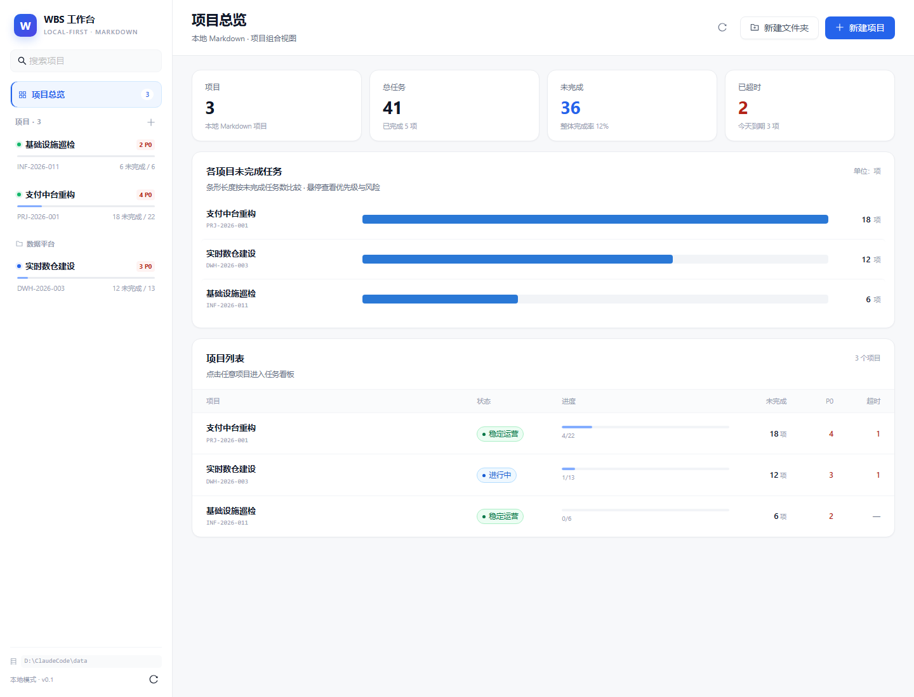
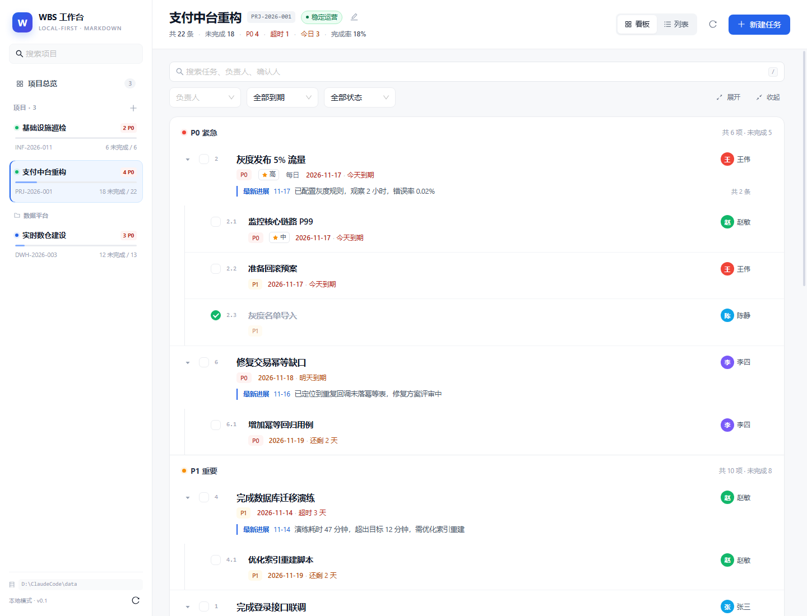
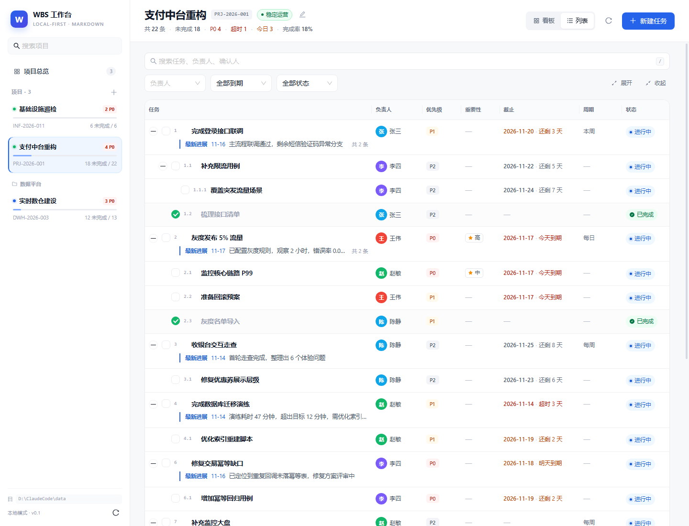
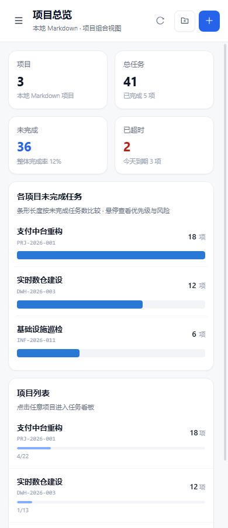

# WBS 工作台

本地运行、浏览器访问的 WBS 项目跟进工具。**Markdown 文件是唯一事实源**：不引入数据库，不做导入/导出；界面上勾选任务、修改字段、追加进展，都会按行写回 `data/` 下对应的 `.md` 文件，同时兼容 Obsidian / VS Code 的手工编辑。



## 功能

- **项目总览**独立页：项目数/任务数/未完成/超时 KPI、各项目未完成任务条形图、项目列表
- 左侧项目/文件夹导航，右侧按优先级分组的看板；可切换 WBS 列表视图
- **页面内直接新建项目/文件夹**；项目名称、编号、状态可在项目页修改
- **项目状态可自定义**：在「设置 → 状态」中增删状态、改名、改色、调整顺序，新建/编辑项目时从清单中选择
- **今日关注**：总览可在「今日关注 / 项目列表」间切换；列表视图悬停任务点图钉标记（已关注的任务图钉常驻显示），按项目分列以贴纸展示，支持改底色、点击打开任务、一键移除（不影响任务本身任何状态）
- **列表宽度自适应**：列宽随字号档位等比缩放、表格始终铺满面板，不再出现「明明够宽却有横向滚动条」
- **品牌区可隐藏**：在「设置 → 品牌」里关闭「显示品牌区」即可收起侧栏顶部的图标与名称（默认显示）
- **快捷设置栏可隐藏**：在「设置 → 外观」里关闭「显示快捷设置栏」即可收起任务页顶部的搜索/筛选/列设置条，看板、列表、甘特图同时生效（默认显示）
- **完成复选框可隐藏**：在「设置 → 外观」里关闭「显示完成复选框」，三个视图任务前的勾选框一并隐藏（默认显示；完成状态仍可在任务详情里改）
- **重要性按颜色区分**：去掉五角星图标，高 / 中 / 低 用与优先级一致的有色标签表示，三档颜色在「设置 → 外观 → 任务标记颜色」里可改（导出文档同步）
- **简介 / 里程碑 / 风险 / 成本 / 相关方五张独立页面**：视图切换前有独立入口，点开即是可编辑的 Markdown 页面（`Ctrl + S` 保存）；简介沿用 `<!-- description:start/end -->` 块，其余页面以 `<!-- page:xxx:start/end -->` 块写进项目 Markdown 本体，也能用外部编辑器直接改；这几个入口按钮之间可直接按住拖动调整先后顺序
- **空白页自带示例模板**：里程碑 / 风险 / 成本 / 相关方还没内容时进入编辑会预填一份表格示例，可以直接在示例上改成自己的内容；若一字未改就保存，这一页按空页面处理——不写入文件、项目信息与导出里也不出现；把内容清空保存则连 `<!-- page:xxx -->` 块一起删掉。空白页只显示一个图标，不显示任何文字提示；简介页没有示例模板
- **里程碑用引用挂任务**：正文里写 `![[2.1]]` 就是引用 2.1 号任务（复用插图的 Obsidian 语法，可写在段落里，也可写进表格单元格），渲染成一张任务卡片（WBS 编号、标题、优先级、状态、联系人、截止、最新进展），点卡片直接切到列表视图并滚动高亮该任务；只有在编辑这一页时，右上角才出现「插入任务」：打开选择器（按名称 / 联系人 / 编号搜索，多选），选中的引用会**原样插到光标所在位置**，位置完全由你决定——单独成段就是一张卡片，写进表格某个单元格（例如加一列「关联任务」）就只占那一格，表格照常渲染。序号优先解析，找不到同名任务时才按图片文件名处理，因此和 `![[图.png]]` 可以混用；写法决定长相——单独成段是一张完整卡片（序号、标题、优先级、状态、联系人、截止、最新进展），写进表格单元格则简化为「序号 标题 优先级」纯文字一行（带省略号，悬停看全名），行高与其他单元格一致，不会把那一行撑高；导出时统一渲染成静态的「序号 标题」
- **项目信息弹窗一页看完**：点项目名称打开，简介与上面四页内容顺序铺在同一页里，没录入内容的板块直接不显示；五张页面的先后顺序可在弹窗内拖动标题调整，顺序写进 Front Matter 的 `pageOrder`，顶部页面按钮同步同一顺序（在顶部拖动按钮也会同步回弹窗）。「项目信息」编辑弹窗只保留名称 / 编号 / 状态，简介改在「简介」页里编辑
- **导出项目完整信息**：「更多」菜单里可选 HTML / PDF，一份文件包含简介、四张页面（按当前顺序）与任务清单全部字段（编号、层级、联系人、优先级、重要性、截止、状态、创建/周期、最新进展）
- **新建任务 / 新建分组收进「更多」菜单顶部**：顶部只保留视图切换与页面入口，避免主按钮占地
- **最新进展展示可调**：在「设置 → 外观 → 列表 · 最新进展」选档位——仅“最新进展”四个字 / 标签 + 日期 / 完整内容（正文尽量展示，任务描述优先占位）；再选位置——靠右贴边 / 紧跟任务描述之后
- **标题不白让宽**：列表行的「最新进展」块按内容自适应，收起日期/正文时同步变窄，宽度全部还给标题；行距与编号列也做了收紧
- **进展支持 Markdown 与多行**：列表行内、悬浮浮窗、详情时间线都按 Markdown 渲染（加粗、代码、链接、列表、表格）；进展可以写多行，换行会原样存进 Markdown 并在浮窗/详情里分行展示
- **关联任务悬浮提示**：鼠标停在某个任务上时（看板、列表都生效），它的前置任务、所属版本任务整行点亮（琥珀底 + 左侧标记），其余任务保持原样
- **版本类型任务**：与标题类型同级的第二种类型（新建任务与详情里都能切换），可挂二级任务，并用自己的截止日期作为交付日期
- **普通任务关联版本**：详情里选「所属版本」后，任务名后会出现可点的「版本」标识，点它直接跳到版本任务；截止日期强制等于版本日期且不可手改，版本日期一改，所有关联任务同步更新；在版本任务下新建的子任务自动归入该版本
- **版本类型配色可改**：版本任务的「版本」标记、版本行标题、甘特图的版本行与版本条共用一套颜色，在「设置 → 外观 → 任务标记颜色 → 版本类型」里改一个颜色即可全局生效（清单、看板、甘特图与导出同步）
- **序号以文件顺序为准**：列表、看板、甘特图显示的是同一套 WBS 编号（按 Markdown 里的行序），不再因为视图内重排而改号；已完成任务也不会再被挪到组尾，行序与编号始终对得上
- **折叠三角统一**：甘特图左侧任务树的展开三角与列表视图保持同一尺寸与悬停反馈
- P0 / P1 / P2 分组，组内按 WBS 序号排列，已完成任务置灰删除线
- 无限级子任务，逐级展开/收起，保留稳定 WBS 编号
- **列表分组管理**：按 Markdown 的 `## 分组标题` 分类展示任务，每组独立表格与序号；分组头字体醒目，可折叠、重命名、删除，可新建分组或在分组内新建任务
- **任务跨组拖动**：把任务拖到另一分组的行或分组头即可移动归类，整棵子树随行、自动重排序号并写回 Markdown；组内拖动仍按上/下边缘调顺序、正中设为子任务
- 联系人（可填多个，顿号分隔）、优先级、**可选重要性标识**、截止日期、周期、确认人/关联人
- 到期推演：`超时 N 天` / `今天到期` / `明天到期` / `还剩 N 天`
- 项目统计现算：总任务、未完成、完成率、P0、超时、今日到期
- 任务行内直接展示「最新进展」，**悬浮时跟随鼠标**显示完整内容
- 任务详情抽屉：字段编辑、状态切换、进展时间线、Markdown 预览
- 一键追加带时间戳的进展，直接写入 Markdown
- 新建任务（可选父任务）、删除任务（删除前备份到 `.wbs-trash/`）
- 文件监听 + SSE：外部编辑器保存后界面自动刷新
- 联系人、到期（已超时 / 今天到期 / 3 天内 / 无截止）、状态（未完成 / 已完成）、任务类型（普通 / 标题 / 版本）与关键词筛选；这四个筛选都是点开浮层多选、默认全部勾选（显示「全部」），取消一项才变成「3/4」这种计数；列表、看板、甘特图共用同一套；展开/收起全部
- 项目与任务深链接、键盘快捷键

项目看板、列表与移动端：





## 快速开始

迁移包已内置 Windows x64 与 x86（32 位）便携版 Node.js 22.23.5（`runtime/x64`、`runtime/x86`），目标电脑无需安装 Node.js；从源码开发时仍要求 Node.js >= 20。

```bash
npm install
npm run dev
```

打开 <http://127.0.0.1:5173>。默认进入**项目总览**，点击项目进入任务看板。开发模式下 Vite 代理 `/api` 到本地服务 `127.0.0.1:5178`。

生产模式：

```bash
npm run build
npm start
```

打开 <http://127.0.0.1:5178>，由 Node 服务同时托管静态页面和 API，默认同样进入项目总览。

### Windows 双击启动

项目根目录提供三个脚本，按需要选择：

| 脚本 | 用途 | 关窗口后 |
|---|---|---|
| `frontground_start.bat` | 前台运行，适合临时使用与查看日志 | 服务随之停止 |
| `background_start.bat` | 后台运行，全程无窗口（启动脚本与常驻服务都不显示命令行窗口）；窗口右下角通知区域会出现托盘图标 | 服务继续运行 |
| `background_stop.bat` | 结束后台运行，并清理运行记录与托盘图标 | — |

三个脚本都会优先使用内置 Node 运行时；依赖与前端构建产物已随包提供，正常启动不会执行安装或构建；自动清理本项目残留的旧服务进程，避免旧接口或端口占用导致启动失败；5178 被其他程序占用时自动改用后续空闲端口；服务就绪后自动打开浏览器。已有另一个 WBS 工作台实例在运行时，脚本会直接打开它。

### 离线迁移到其他电脑（Windows x64 / x86）

1. 解压整个目录，保持 `runtime/`、`node_modules/`、`web/dist/` 与源码在同一层。
2. 双击 `frontground_start.bat` 或 `background_start.bat`。启动脚本会按系统架构选择 `runtime\x64\node.exe` 或 `runtime\x86\node.exe`，只有本地运行时缺失时才回退到系统 Node.js 20+。
3. 包内已包含运行依赖与前端构建产物；`runtime/` 仅保留两套 `node.exe` 与许可证，未内置 npm，启动时直接使用 `web/dist`，无需联网。
4. 如需在目标机修改前端源码并重新构建，需要自行安装 Node.js/npm；正常使用不需要。

后台启动通过 `scripts/start-hidden.vbs` 以隐藏窗口方式拉起，双击 `background_start.bat` 后窗口会立即消失，不会留下空白命令行窗口。进程信息与端口记录在 `.wbs-runtime.json`；启动日志在 `wbs-launcher.log`，服务日志在 `wbs-background-<端口>.log`（均已加入 `.gitignore`）。`background_stop.bat` 只停止本项目的后台进程，不会影响其他程序或其他实例。

### 系统托盘图标（仅后台启动）

`background_start.bat` 会在 Windows 通知区域（桌面右下角）放一个图标，图标取自设置里的品牌图标文字、颜色和圆角，由 `scripts/tray.ps1` 提供，只使用 Windows 自带的 PowerShell 5.1，不需要安装任何额外组件。

- 鼠标悬停：显示服务状态与端口。
- 左键双击 / 菜单「打开工作台」：在默认浏览器打开当前服务地址。
- 菜单「复制访问地址」：把 `http://127.0.0.1:<端口>` 复制到剪贴板。
- 菜单「退出服务」：停止后台服务，等同运行 `background_stop.bat`，图标同时消失。
- 用 `background_stop.bat` 停止服务时，托盘图标会被一起关闭；服务若异常退出，图标也会在几秒内自动收起。

新出现的图标可能被 Windows 收进「^」折叠区，把它拖到可见区域后系统会记住位置。不需要托盘时，可设置环境变量 `WBS_NO_TRAY=1` 再启动。托盘自身的诊断日志是 `wbs-tray.log`（已忽略，不会进迁移包）。

也可用命令行直接操作：`node scripts/launch.mjs --background`、`node scripts/launch.mjs --stop`。

可用环境变量：

| 变量 | 默认值 | 说明 |
|---|---|---|
| `WBS_DATA_DIR` | `./data` | Markdown 数据目录，相对仓库根目录或绝对路径 |
| `PORT` | `5178` | 本地服务端口 |
| `HOST` | `127.0.0.1` | 默认只监听本机 |
| `WBS_NO_TRAY` | 未设置 | 设为 `1` 时后台启动不创建托盘图标 |
| `WBS_NODE_ARCH` | 自动识别 | 强制使用 `x64` 或 `x86` 的内置运行时 |

```bash
# 使用自己的工作目录
WBS_DATA_DIR=D:/work/wbs npm run dev
```

## 数据文件规范

一个 `.md` 文件对应一个项目。Front Matter 是项目元数据，正文用 Markdown 复选框表达 WBS：

```markdown
---
wbs: 1
project: 支付中台重构
code: PRJ-2026-001
status: 稳定运营
owner: 王伟
updated: 2026-11-17T09:30:00+08:00
---

# 支付中台重构

## 联调与上线

- [ ] 完成登录接口联调 [owner::张三] [priority::P1] [importance::高] [due::2026-11-20] [cycle::本周] [confirm::李四] <!-- id:t_7f3a01 -->
  - 2026-11-16 17:40 [by::张三] 主流程联调通过，剩余异常分支
  - [ ] 补充限流用例 [owner::李四] [priority::P2] [due::2026-11-22] <!-- id:t_7f3a02 -->
  - [x] 梳理接口清单 [owner::张三] [priority::P2] <!-- id:t_7f3a03 -->
- [ ] 灰度发布 5% 流量 [owner::王伟] [priority::P0] [due::2026-11-17] <!-- id:t_7f3a04 -->
```

规则：

- **缩进 = WBS 层级**。每级 2 个空格；手工文件使用递增缩进也能解析，Web 写回统一为 2 空格。
- **复选框 = 状态**。`[ ]` 未完成，`[x]` 已完成；父任务完成度只派生显示，不自动改写。
- **简介与四张页面**都是 Front Matter 与一级标题之间的标记块，块内标题不会当成分组：
  `<!-- description:start -->…<!-- description:end -->`（简介页）、`<!-- page:milestone|risk|cost|stakeholder:start -->…<!-- …:end -->`。
  页面展示顺序保存在 Front Matter 的 `pageOrder`，缺省为 `["intro", "stakeholder", "risk", "milestone", "cost"]`（简介、相关方、风险、里程碑、成本）；旧项目若已保存自己的顺序则继续沿用，缺少的页面补在末尾。
- **内联字段**采用 `[key::value]`。支持的中文别名：`联系人/负责人` `优先级` `重要性/重要度` `截止/截止日期` `周期` `确认人/关联人`（两个别名都映射到同一个 `owner` 字段，存量文件无需改动）。未知字段会保留。
- **重要性**是可选字段（界面建议 `高 / 中 / 低`）；留空时任务行不显示任何重要性标识。
- **进展记录**是缩进更深的、以日期开头的普通列表项：`- 2026-11-16 17:40 [by::张三] 内容`。单行存储，支持行内 Markdown（粗体、代码、链接等）。
- **稳定 ID** 放在行尾 HTML 注释 `<!-- id:t_xxx -->` 中。手工新建的任务可以没有 ID，首次在 Web 端编辑时会自动补上。
- `## 标题` 作为阶段/分组；任何标题都会结束当前任务层级。列表模式下，每个 `## 标题` 即一个可管理的任务分组；`## 标题` 之前的任务归入「未分组」。跨组拖动、分组重命名/删除都只改写对应的标题行或任务块。
- 标题中不要出现 `[key::value]` 形式，这是保留语法。
- 解析器只改写被操作的那一行，其余行（包括你的备注、空行、引用、代码块）逐字节保留。

## 项目管理

- 启动后进入**项目总览**；左侧「项目总览」入口随时返回。
- 总览顶部和左侧「项目」标题旁都有新建入口：
  - **新建项目**：填写名称、编号、状态即可；默认保存到「设置 → 项目目录」，从左侧某个文件夹旁的新建入口打开时保存到该文件夹，创建后自动打开。
  - **新建文件夹**：支持 `客户项目/2027` 这样的多级路径；空文件夹会立即出现在导航中。
- 项目页标题右侧的铅笔图标可修改**项目名称、编号、状态**。修改会更新 Front Matter；若一级标题与原名一致也会同步，但**不会重命名文件或改变已有链接**。
- 重名项目会生成 `名称-2.md` 等不冲突的文件名。

## 交互说明

- 点击任务行打开详情抽屉；勾选复选框立即写回文件。
- 详情抽屉里修改字段后点击「保存字段」；标题输入框可直接编辑。
- **重要性**在新任务、详情抽屉中可选；未选择时看板不显示标识。
- 进展输入框支持 Markdown 和预览，`Ctrl / ⌘ + Enter` 提交。
- 鼠标悬停任务行内的「最新进展」时，会显示跟随鼠标的完整内容浮窗；移动端可在详情抽屉查看历史进展。
- 任务行悬停出现 `+`，可快速为该任务添加子任务。
- 顶部可切换看板/列表/甘特图；筛选条支持联系人、到期、状态、任务类型与关键词，前四项都是多选浮层（默认全选），三个视图共用并互相保持。甘特图工具条只保留「日 / 周 / 月」「今天」「依赖线」，不再重复放「仅未完成」「含版本」。
- 快捷键：`/` 聚焦搜索，`N` 新建任务（「更多」菜单的「新建任务」右侧标了这个键）；新建任务时在名称框里按回车即创建。
- 项目会同步到地址栏，例如 `?project=<id>&view=list`；`?page=overview` 返回总览；`?task=<id>` 可直接打开任务详情。
- 删除任务会把原文件备份到 `data/.wbs-trash/`（隐藏目录，不参与扫描）。

## 技术实现

```
浏览器 React 18 + Ant Design 5 + Zustand
        │ REST / SSE
Node + Express（127.0.0.1:5178）
        │
data/**/*.md  ← 唯一事实源
```

- 解析器（`shared/src/parser.ts`）是纯函数、行级解析，不用 Markdown AST；因此写回可以只替换一行，保证手工编辑不被打乱。
- 所有写操作走同一把文件锁，读-改-写后校验 mtime/size；检测到外部修改会重新解析并按任务 ID 重放补丁，临时文件 + rename 原子替换。
- 文件变更通过 chokidar 监听，经 SSE 推送给前端；SSE 断开自动重连。
- 统计、超时、完成度全部由当前树派生，不写回文件，避免漂移。项目总览的 KPI 与条形图直接由各项目摘要汇总。
- 新建项目/文件夹、修改项目信息走独立 API；项目信息修改只动 Front Matter 与匹配的一级标题，文件名保持不变。
- 路径必须落在数据目录内且为 `.md`；默认只监听 `127.0.0.1`。Markdown 渲染经 DOMPurify 清理。
- 「最新进展」浮窗使用固定定位的 Portal，随指针移动并做视口边缘避让；滚动或移出即消失。

类型检查：

```bash
npm run typecheck
```

## 目录

```
data/                       示例项目（可直接替换）
shared/src/                 类型、Markdown 解析/序列化、统计与到期计算
server/src/                 Express API、文件锁/原子写、监听与 SSE
web/src/                    React 页面、看板/列表、详情抽屉、状态管理
docs/                       README 预览图
```

## 边界与限制

- 面向本地单用户；不做多人协同或内容级合并。外部编辑器与页面同时写同一文件时，会检测冲突并重试，极端情况下以最后一次重试为准。
- 进展按「首行 + 缩进续行」存储，多行内容会保留换行；单条上限 2000 字符。
- 「周期」目前是展示与筛选元数据，不自动重置任务。
- **重要性**为可选文本标识，界面建议高/中/低；留空不显示，也不影响优先级排序。
- 项目总览的柱状图为单系列「未完成任务数」，优先级与超时详情在悬浮提示和项目列表中；项目列表同时充当图表的表格视图。
- 修改项目名称不会重命名 Markdown 文件，以免破坏已有链接和项目 ID。
- 空文件夹会保留在导航中；删除文件夹请直接在文件系统中操作。
- 默认无鉴权，只建议本机使用；若开放局域网，请自行增加访问控制。
- 示例数据中的日期以 2026-11-17 为基准，打开后可直接看到「今天到期/超时」等状态。
